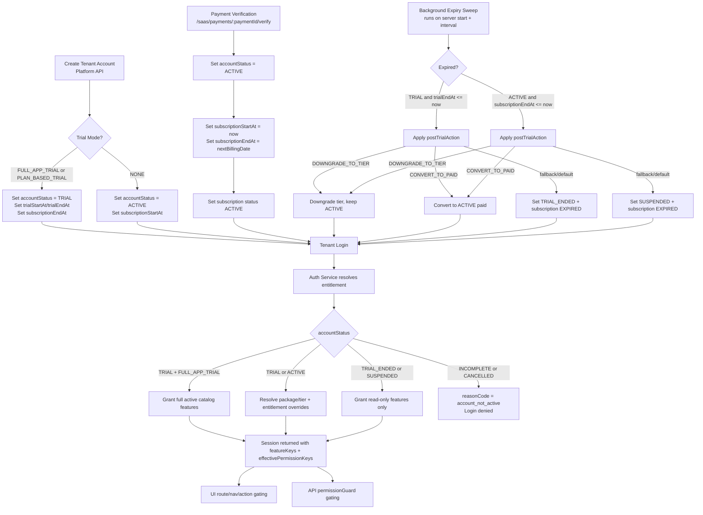

# Account Activation, Access, Deactivation, and Payment Workflow

This document explains the current implemented flow across backend and frontend for tenant account lifecycle.

## 1) End-to-End Graph

## 2) Step-by-Step Explanation

### Step A: Account provisioning
- Platform creates tenant account with package and tier selection.
- Trial policy is derived using tier-first, then package defaults.
- Depending on trial mode, account starts in TRIAL or ACTIVE.

### Step B: Login and entitlement resolution
- Tenant login authenticates account + user.
- Resolver computes effective features from:
  - account status
  - package/tier features
  - tenant entitlement overrides (add-ons, custom grants, suspended features)
  - dependency expansion
- If resolver returns reasonCode, login/session is denied.

### Step C: Access control in runtime
- Session carries:
  - featureKeys (subscription-level features)
  - effectivePermissionKeys (role-filtered permissions)
  - effectiveFeatureConfigs
- UI uses these keys for route, nav, and action gating.
- API enforces again through permissionGuard middleware.

### Step D: Payment activation flow
- Payment verification endpoint updates commercial state.
- On successful verify:
  - accountStatus becomes ACTIVE
  - subscriptionStartAt is set to now
  - subscriptionEndAt is set to next billing date
  - subscription row becomes ACTIVE

### Step E: Expiry and deactivation flow
- Background expiry sweep runs on startup and at intervals.
- For expired TRIAL (trialEndAt passed):
  - applies postTrialAction (DOWNGRADE_TO_TIER or CONVERT_TO_PAID)
  - if not applicable, sets TRIAL_ENDED
- For expired ACTIVE (subscriptionEndAt passed):
  - applies postTrialAction
  - if not applicable, sets SUSPENDED

### Step F: Post-expiry access behavior
- TRIAL_ENDED and SUSPENDED are currently resolved as read-only access, not complete denial.
- INCOMPLETE and CANCELLED are denied as account_not_active.

## 3) Important Current Behavior

The current system is not "only ACTIVE paid accounts can access".
Current behavior allows:
- TRIAL access
- TRIAL_ENDED and SUSPENDED read-only access
- only INCOMPLETE/CANCELLED fully blocked

If strict paid-only access is required, resolver and login policy must be tightened to deny non-ACTIVE states.
